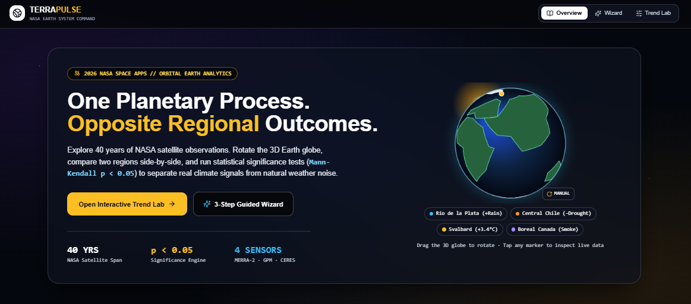
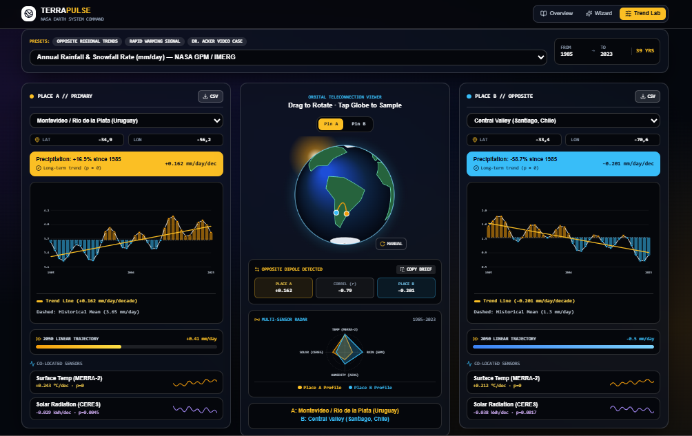
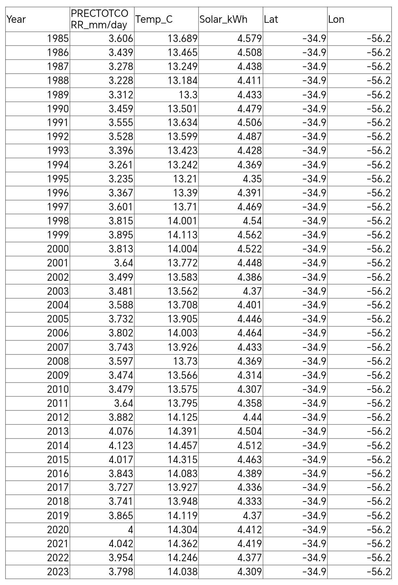
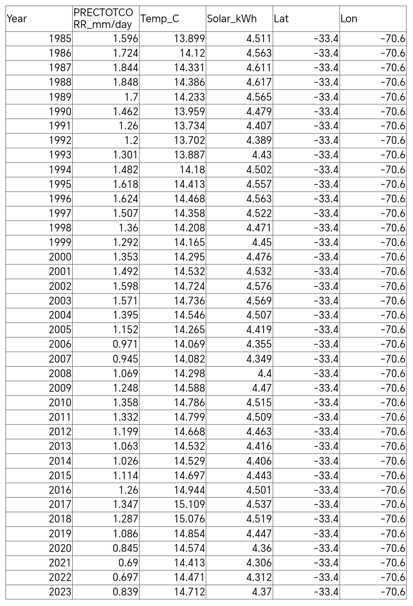

# TERRA-PULSE // NASA Earth System Trend Detective

**Live interactive web app:** https://terra-pulse-gamma.vercel.app
**GitHub repository:** https://github.com/Lizziegonzz22/terra-pulse
**Challenge:** *Be An Earth System Trend Detective!* — 2026 NASA Space Apps Challenge (Uruguay)



> **One planetary process. Opposite regional outcomes.**
> TERRA-PULSE lets anyone explore four decades of NASA satellite records, compare two places on Earth side by side, and test with real statistics whether a change is a true climate signal or just natural weather noise.

---

## Table of contents

1. [Overview & scientific problem](#1-overview--scientific-problem)
2. [Core features](#2-core-features)
3. [NASA Earth science data & sensors](#3-nasa-earth-science-data--sensors)
4. [Example finding: Río de la Plata vs. Central Chile](#4-example-finding-río-de-la-plata-vs-central-chile)
5. [Statistical methodology](#5-statistical-methodology)
6. [Project architecture & folder structure](#6-project-architecture--folder-structure)
7. [Tech stack & local installation](#7-tech-stack--local-installation)
8. [How TERRA-PULSE maps to the judging criteria](#9-how-terra-pulse-maps-to-the-judging-criteria)
9. [References, AI disclosure & license](#10-references-ai-disclosure--license)

---

## 1. Overview & scientific problem

Climate change is not uniform. The same large-scale planetary process (for example the El Niño–Southern Oscillation, ENSO) can bring **wetter decades to one region and severe multi-decade drought to another**. Short time windows make this even harder to read: a trend that looks obvious over 13 years often disappears, or reverses, over 35+ years.

TERRA-PULSE is an interactive Earth observation and statistical analytics web application that lets users:

- explore **39 years of NASA satellite-derived records (1985–2023)** on a 3D globe,
- compare **two contrasting regions** with the same sensor and the same time window,
- run an automated **significance engine (p < 0.05)** to separate real climate signals from interannual variability,
- detect **opposite regional "dipoles"** such as ENSO-linked rainfall, Arctic amplification, and wildfire-smoke dimming.

The app is designed for learners, not only specialists: a guided wizard configures the right NASA sensor and regions for you.

---

## 2. Core features

| Feature | Components | What it does |
|---|---|---|
| **Mission Overview & 3D Orbital Globe** | `MissionOverview.tsx`, `OrbitalGlobe.tsx` | HTML5 Canvas 3D globe with smooth drag rotation, day/night shading and location pins. One-click access to the featured teleconnection cases (Montevideo vs. Santiago, Svalbard vs. Galápagos, Central Saskatchewan vs. Madison). |
| **3-Step Guided Investigation Wizard** | `DetectiveWizard.tsx` | Choose an environment, a physical change and a time window (long-term 35+ years vs. short ~13 years). The wizard recommends the matching NASA sensor and two regions, and opens them in the Trend Lab. |
| **Dual-Region Trend Lab** | `RegionPanel.tsx`, `TrendChart.tsx`, `TrajectoryBar.tsx`, `WorldPickerMap.tsx` | Side-by-side analysis of 6 pre-configured monitoring regions or any custom coordinates. SVG telemetry charts with anomaly bars, OLS trend line and historical mean, a 2050 linear trajectory indicator, co-located multi-sensor readouts and one-click CSV export. |
| **Teleconnection Dipole Meter & Multi-Sensor Radar** | `TeleconnectionMeter.tsx`, `AnomalyRadar.tsx` | Computes the Pearson correlation between the two regions to flag inverse or synchronized dipoles, and overlays normalized anomalies for temperature, rainfall, solar radiation and humidity on a radar chart. |

**Quick-start presets in the Trend Lab**

- **Opposite Regional Trends**: Río de la Plata vs. Central Chile (rainfall).
- **Rapid Warming Signal**: Svalbard (High Arctic) vs. Galápagos (Equator).
- **Dr. Acker Video Case**: Central Saskatchewan (boreal forest) vs. Madison, Wisconsin (downwind path), inspired by NASA oceanographer Dr. James Acker's explanation of wildfire smoke dimming sunlight far downwind.

**Pre-configured regions:** Montevideo / Río de la Plata (Uruguay), Central Valley (Santiago, Chile), Svalbard Archipelago (High Arctic), Galápagos Marine Reserve (Equator), Central Saskatchewan (Boreal Forest) and Madison, Wisconsin (Downwind Path).



---

## 3. NASA Earth science data & sensors

TERRA-PULSE queries homogenized annual time series from the **NASA Langley Research Center (LaRC) POWER Project** (`power.larc.nasa.gov`), with request caching and a climatological fallback engine for when the API is unavailable.

| Parameter | NASA source | Unit | Used for |
|---|---|---|---|
| `T2M` | MERRA-2 / GEOS | °C | Surface air temperature at 2 m: warming rates and polar amplification |
| `PRECTOTCORR` | GPM / IMERG | mm/day | Bias-corrected total precipitation: wetting trends and megadroughts |
| `ALLSKY_SFC_SW_DWN` | CERES / MODIS | kWh/m²/day | All-sky surface shortwave irradiance: wildfire smoke dimming |
| `QV2M` | AIRS / MERRA-2 | g/kg | Specific humidity at 2 m: atmospheric water vapor capacity |

### Scientific CSV export (multi-sensor telemetry)

Every regional panel exports a CSV that combines the primary telemetry with co-located temperature (`Temp_C`), solar irradiance (`Solar_kWh`) and the exact coordinates (`Lat`, `Lon`), so results can be reproduced and re-analyzed outside the app.

| Montevideo / Río de la Plata (Lat -34.9, Lon -56.2) | Central Valley, Chile (Lat -33.4, Lon -70.6) |
|---|---|
|  |  |

---

## 4. Example finding: Río de la Plata vs. Central Chile

Using *Annual Rainfall & Snowfall Rate* (NASA GPM / IMERG), 1985–2023:

| | Montevideo / Río de la Plata | Central Valley (Santiago) |
|---|---|---|
| Precipitation change since 1985 | **+16.9 %** | **−58.7 %** |
| Trend | +0.162 mm/day per decade | −0.201 mm/day per decade |
| Co-located surface temperature (MERRA-2) | +0.243 °C per decade | +0.212 °C per decade |
| Co-located solar radiation (CERES) | −0.029 kWh/m²/day per decade (p = 0.0045) | −0.038 kWh/m²/day per decade (p = 0.0017) |

The two series have a **Pearson correlation of r = −0.79**, which the Dipole Meter reports as an **opposite dipole**: the same Pacific climate cycle that brings wetter decades to Uruguay and southeastern South America coincides with a severe multi-decade drought across the Andes in Chile.

---

## 5. Statistical methodology

Implemented in `src/engine/statistics.ts` and evaluated in real time in the browser:

- **Ordinary Least Squares (OLS) linear regression**: slope, change per decade, percentage change versus the first years of the record, and 95 % confidence intervals.
- **Mann–Kendall trend test** (non-parametric): statistic *S*, variance, standardized *Z*-score and two-tailed *p*-value, compared against the **p < 0.05** threshold.
- **Pearson linear correlation (r)** between the two selected regions, used by the Teleconnection Dipole Meter.
- **Linear trajectory to 2050**: simple extrapolation of the fitted trend, shown as an indicator and **not** as a climate forecast.

Using both OLS and Mann–Kendall means a trend is only called significant when it holds up under a test that does not assume normally distributed data.

---

## 6. Project architecture & folder structure

```text
terra-pulse/
├── index.html                 # Application entry HTML & metadata
├── package.json               # Dependencies and build scripts
├── postcss.config.js          # PostCSS configuration (Tailwind CSS pipeline)
├── tailwind.config.js         # Custom dark orbital UI theme
├── tsconfig.json              # TypeScript compiler configuration
├── vite.config.ts             # Vite bundler setup
├── .gitignore                 # Files excluded from version control
├── LICENSE                    # MIT license
├── README.md                  # This file
├── docs/                      # Screenshots and CSV samples used in this README
│   ├── overview.png
│   ├── trend-lab.png
│   ├── csv-montevideo.png
│   └── csv-chile.png
└── src/
    ├── main.tsx               # React DOM root initialization
    ├── index.css              # Global styles and custom utilities
    ├── App.tsx                # Main navigation state (Overview / Wizard / Trend Lab)
    ├── types/
    │   └── climate.ts         # TypeScript interfaces for sensors, regions and results
    ├── services/
    │   └── nasaPowerApi.ts    # NASA LaRC POWER API client + caching + fallback
    ├── engine/
    │   └── statistics.ts      # OLS regression, 95% CI, Mann-Kendall, Pearson r
    └── components/
        ├── MissionOverview.tsx      # Landing view, KPI banner, featured cases
        ├── DetectiveWizard.tsx      # 3-step guided investigation builder
        ├── OrbitalGlobe.tsx         # Interactive 3D orthographic Earth (Canvas)
        ├── WorldPickerMap.tsx       # Interactive coordinate & region picker
        ├── RegionPanel.tsx          # Telemetry card, OLS stats, CSV export
        ├── TrendChart.tsx           # SVG time-series chart with baseline & trend line
        ├── TrajectoryBar.tsx        # Linear projection indicator to 2050
        ├── TeleconnectionMeter.tsx  # Dual-region dipole detector & correlation
        └── AnomalyRadar.tsx         # 4-sensor comparative anomaly radar
```

---

## 7. Tech stack & local installation

**Stack:** React 18, TypeScript, Vite, Tailwind CSS, a custom HTML5 Canvas 3D orthographic globe, the NASA LaRC POWER API, and Vercel hosting.

**Run it locally**

```bash
git clone https://github.com/Lizziegonzz22/terra-pulse.git
cd terra-pulse
npm install
npm run dev      # development server
npm run build    # production build
```

No API key is required: the NASA POWER API is open and free to use.


---

## 8. How TERRA-PULSE maps to the judging criteria

| Criterion | How the project responds |
|---|---|
| **Impact** | Makes climate-trend analysis accessible to students, teachers and citizens without any coding. |
| **Creativity** | Dual-region "dipole" storytelling on an interactive 3D globe, plus a detective-style guided wizard. |
| **Validity** | Real NASA data, OLS with 95 % CI, Mann–Kendall significance testing, reproducible CSV exports and openly stated limitations. |
| **Relevance** | Directly addresses *Be An Earth System Trend Detective!* by comparing regional trends across multiple NASA sensors. |
| **Presentation** | Clear overview, guided flow, color-coded A/B regions and one-click demo cases. |

---

## 9. References, AI disclosure & license

**Data and methods**

- NASA Prediction Of Worldwide Energy Resources (POWER) Project, NASA Langley Research Center. https://power.larc.nasa.gov
- MERRA-2 reanalysis, NASA Global Modeling and Assimilation Office (GMAO). Gelaro, R. et al. (2017), *Journal of Climate*, 30(14), 5419–5454.
- GPM / IMERG precipitation, NASA Goddard Earth Sciences Data and Information Services Center (GES DISC).
- CERES surface radiation, NASA Langley Research Center.
- AIRS atmospheric humidity, NASA GES DISC.
- Mann, H. B. (1945). Nonparametric tests against trend. *Econometrica*, 13(3), 245–259.
- Kendall, M. G. (1975). *Rank Correlation Methods*. Griffin, London.
- Wildfire smoke dimming case inspired by NASA oceanographer Dr. James Acker's explanation provided in the 2026 Space Apps challenge resources.

**AI assistance disclosure**

AI assistants (Claude, GitHub Copilot and Google Gemini) were used during the hackathon for initial brainstorming, documentation structure, UI copy refinement and README drafting. All system architecture, statistical engines and scientific integrations were independently built and verified by the team.

**License**

Open source under the [MIT License](LICENSE).

**Built for** the 2026 NASA Space Apps Challenge, with Space Uruguay. `#SpaceApps #SpaceAppsUruguay`
